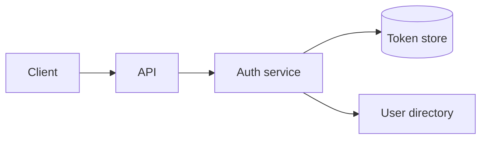

# Templates

## An area file

```markdown
# Auth

*Informative.* A client trades a refresh token for a new pair. Each refresh
token works once, because the auth service revokes it during the trade. A
second use means that someone copied it, so the auth service revokes every
token of that family.

## Assumptions

- The clocks of all auth service instances agree within 1 second. The
  deployment platform runs NTP on each instance. `[auth.assume.clock-sync]`

## Rules

- The auth service MUST issue a new refresh token on every refresh. `[auth.rotate]`
- The auth service MUST revoke the presented refresh token before it returns
  the new one. `[auth.revoke-before-return]`
- The auth service MUST revoke the token family on reuse of a revoked token.
  `[auth.family-revoke]`

  *Implementation status: planned.* New text: "…more than 10 seconds after its
  revocation."

**Why:** `[auth.rotate]` and `[auth.revoke-before-return]` together make a
stolen token single-use. See [the rotation decision](../designs/2026-11-01-rotation-design.md#decision-revoke-the-family-on-any-reuse).
```

## An architecture document

````markdown
# Architecture

Token service of the shop. Mobile and web clients trade refresh tokens for
access tokens. It talks to one external system: the user directory.

## Components



- API: validates requests and routes them. Spec: `docs/spec/api.md`
- Auth service: issues, rotates and revokes tokens. Spec: `docs/spec/auth.md`
- Token store: keeps token families.

## Key assumptions and goals

- Reads outnumber writes 100 to 1.
- Consistency over availability: a revoked token is never accepted.

## Invariants

- Only the token store writes token data.
- Every token leaves the service signed.

## Code map

- `src/api/`: API
- `src/auth/`: auth service
- `src/store/`: token store
````
